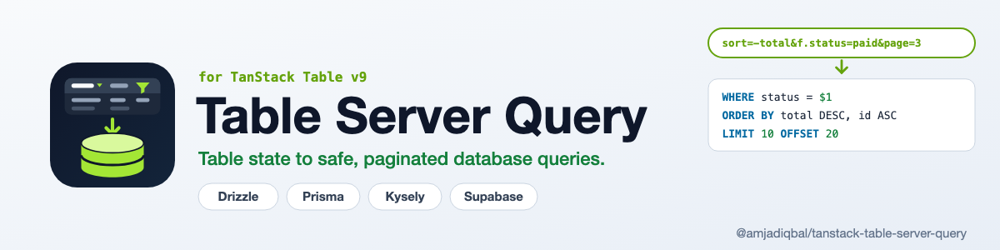

<p align="center">
  <picture>
    <source media="(prefers-color-scheme: dark)" srcset="art/banner-dark.png">
    
  </picture>
</p>

# TanStack Table Server Query: server-side sorting, filtering and pagination for Drizzle, Prisma, Kysely and Supabase

Turn **TanStack Table v9** state (sorting, column filters, global filter, pagination) into
**server-side database queries**. One column allow-list validates what the client sends, then a
small adapter applies it to **Drizzle**, **Prisma**, **Kysely** or **Supabase** (PostgREST) and
returns the rows plus the total count your manually paginated table needs.

[](https://www.npmjs.com/package/@amjadiqbal/tanstack-table-server-query)
[](https://bundlejs.com/?q=@amjadiqbal/tanstack-table-server-query)
[](LICENSE.md)

```
?sort=-total&f.status=paid&page=3   →   WHERE status = $1 ORDER BY total DESC, id ASC LIMIT 10 OFFSET 20
```

- **Allow-list first.** Only the columns you list can be sorted or filtered, each with its own
  operators. Unknown columns, operators and badly typed values are rejected with a 400-style error.
- **Values are always bound parameters.** Column names come from your config, never from the request.
  `%`, `_` and `\` in search text are escaped, so `50%` finds "50%", not everything starting with 50.
- **Limits built in:** a request over the page size limit (default 100), page index limit, number of
  filters and sorts, `in` list length or string length is rejected (or capped/dropped with
  `invalid: 'ignore'`, see [Errors](#errors)).
- **Filters by column type:** `string`, `enum`, `number`, `date`, `boolean`, with `eq`, `ne`, `lt`,
  `lte`, `gt`, `gte`, `between`, `in`, `notIn`, `contains`, `startsWith`, `endsWith`, `isNull`,
  `isNotNull`. Number and date ranges behave like Table's `inNumberRange` / `inDateRange`.
- **Rows plus `rowCount` and `pageCount`** from one helper call per adapter (two queries, see
  [Consistent counts](#consistent-counts)).
- **Reads what the client already has:** table state from a request body, `URLSearchParams`, a query
  string, or TanStack Router's `search` object, in the same URL format as
  [`@amjadiqbal/tanstack-table-url-state`](https://github.com/amjadiqbal/tanstack-table-url-state).
- **Standard Schema validator**, so the definition plugs straight into a TanStack Start server
  function's `.validator()`.
- Typed, ESM-only, `sideEffects: false`, no runtime dependencies, no telemetry, no network calls.

Community package, not affiliated with TanStack, Drizzle, Prisma, Kysely or Supabase.

## Install

```bash
npm i @amjadiqbal/tanstack-table-server-query
```

Install the ORM you use as usual. `drizzle-orm` (>= 0.36) and `kysely` (>= 0.27) are optional peer
dependencies of their adapters; both the lowest and the current versions are tested (see below). The Prisma and Supabase adapters import nothing: they build plain
arguments and call the client you pass in.

## 1. Define the allow-list

```ts
import { defineTableQuery } from '@amjadiqbal/tanstack-table-server-query'

export const ordersQuery = defineTableQuery({
  columns: {
    customer: { type: 'string' },
    status: { type: 'enum', values: ['paid', 'pending', 'refunded'] },
    total: { type: 'number' },
    placedAt: { type: 'date', field: 'placed_at' }, // `field` = DB column / ORM field, default = the id
    paid: { type: 'boolean' },
    email: { type: 'string', ops: ['eq'], defaultOp: 'eq', sortable: false },
  },
  defaultSorting: [{ id: 'placedAt', desc: true }],
  tiebreaker: 'id',                             // appended to ORDER BY so pages are stable
  globalFilter: { columns: ['customer', 'email'] },
  maxPageSize: 50,
})
```

The column ids are the ids of your Table columns. Anything that is not listed cannot be used.

## 2. Parse the request

```ts
const query = ordersQuery.parse(input)
```

`input` can be any of the following. An object with a `sorting`, `columnFilters`, `globalFilter` or
`pagination` key is read as Table state; any other object is read as search params.

| Input | Example |
|---|---|
| Table state (request body) | `{ sorting, columnFilters, globalFilter, pagination }` |
| `URLSearchParams` or a query string | `'?sort=-total,customer&f.status=paid&f.total=[100,500]&q=acme&page=3&size=20'` |
| A search object (TanStack Router `search`) | `{ sort: '-total', 'f.status': 'paid', page: 3 }` |

`parse()` throws a `TableQueryError` (`.status` is 400, `.issues` lists each problem with its path).
`safeParse()` returns `{ success, data | error }`. With `invalid: 'ignore'` bad parts are dropped and
listed in `query.issues` instead, which suits hand-edited URLs.

Normalisation worth knowing:

- The global filter is trimmed; a number (`q=42` read by the Router as `42`) is used as the text `"42"`.
  An empty or all-space search means no search.
- A column listed twice in `sorting` is used once, at its first position.
- With a `tiebreaker`, that field is appended ascending unless the request already sorts on it.

The result is a plain, database-neutral description:

```ts
{
  sorting: [{ id: 'total', field: 'total', desc: true }, { id: 'id', field: 'id', desc: false }],
  filters: [{ id: 'status', field: 'status', type: 'enum', op: 'eq', value: 'paid' }],
  globalFilter: { value: 'acme', fields: ['customer', 'email'] },  // or null
  pagination: { pageIndex: 2, pageSize: 20, offset: 40, limit: 20 },
  issues: [],
}
```

## 3. Run it

### Drizzle

```ts
import { queryDrizzle, toDrizzle } from '@amjadiqbal/tanstack-table-server-query/drizzle'

const page = await queryDrizzle(db, orders, query)
// { rows, rowCount, pageCount, pageIndex, pageSize }

// Or take the parts and build the select yourself (joins, custom selections):
const { where, orderBy, limit, offset } = toDrizzle(query, orders)
const rows = await db.select().from(orders).where(where).orderBy(...orderBy).limit(limit).offset(offset)
```

`field` names the property on the Drizzle table (`placedAt`, not `placed_at`). For joins or
computed columns pass a map instead of the table: `toDrizzle(query, { total: orders.total, customer: customers.name })`.
`drizzleWhere(query, source)` returns only the WHERE clause.

### Prisma

```ts
import { queryPrisma, toPrisma } from '@amjadiqbal/tanstack-table-server-query/prisma'

const page = await queryPrisma(prisma.order, query)                          // findMany + count
const args = toPrisma(query)                                                 // { where, orderBy, skip, take }
const rows = await prisma.order.findMany({ ...args, include: { customer: true } })
```

`field` names the Prisma model field. Text filters and the global filter use `mode: 'insensitive'`
(PostgreSQL); pass `{ insensitive: false }` on databases without it. Prisma does not escape `%`
and `_` in `contains` / `startsWith` / `endsWith`, so this adapter does (`escapeWildcards`, default
`true`). It puts a `\` before `%`, `_` and `\`, and Prisma's query has no `ESCAPE` clause, so this
relies on `\` being the database's default LIKE escape character, as it is on PostgreSQL. The Prisma
adapter is tested on PostgreSQL only.

### Kysely

```ts
import { applyKysely, queryKysely } from '@amjadiqbal/tanstack-table-server-query/kysely'

const page = await queryKysely(db, 'orders', query)
const rows = await applyKysely(db.selectFrom('orders as o').select(['o.id', 'o.total']), query).execute()
```

`field` names the database column and may be qualified (`'o.total'`). `applyKyselyWhere()` adds only
the WHERE clause.

### Supabase (PostgREST)

```ts
import { querySupabase, applySupabase } from '@amjadiqbal/tanstack-table-server-query/supabase'

const page = await querySupabase(supabase.from('orders'), query)            // rows + count: 'exact'
const { data, count } = await applySupabase(supabase.from('orders').select('*', { count: 'exact' }), query)
```

`field` names the database column. Values in `or()` and `not.in` lists are quoted, so commas,
parentheses and quotes in search text cannot change the filter. `querySupabase()` normally makes one
request (rows plus `count: 'exact'`). For a page past the end PostgREST answers 416 (`PGRST103`); the
adapter then sends a second, head-only request with the same filters and returns no rows with the
right count. PostgREST turns `*` in `ilike` patterns into a
wildcard, so a `*` typed into a search box matches anything there.

## Consistent counts

`queryDrizzle()`, `queryKysely()` and `queryPrisma()` run the rows query and the count query at the
same time (`Promise.all`), not in a transaction. If rows are written in between, `rowCount` can
disagree with the rows by a few. When that matters, run the same helper inside a `REPEATABLE READ`
transaction, so both queries read one snapshot (PostgreSQL; these three recipes are tested):

```ts
// Drizzle (node-postgres)
const page = await db.transaction((tx) => queryDrizzle(tx, orders, query), { isolationLevel: 'repeatable read' })

// Kysely
const page = await db.transaction().setIsolationLevel('repeatable read').execute((trx) => queryKysely(trx, 'orders', query))

// Prisma
const page = await prisma.$transaction((tx) => queryPrisma(tx.order, query), { isolationLevel: 'RepeatableRead' })
```

`querySupabase()` gets rows and count from one PostgREST request, except for a page past the end
(see above).

## TanStack Start

The definition is a [Standard Schema](https://standardschema.dev), so a server function can use it
as its validator and receive the parsed query. There is no separate Start helper: the object returned
by `defineTableQuery()` implements Standard Schema v1 itself (`~standard`), and Start's validator reads
`~standard` before anything else. The newest Start on npm on 2026-10-23, `@tanstack/react-start`
1.169.4 (`@tanstack/start-client-core` 1.170.39), names the method `.validator()`; that is the version
tested:

```ts
import { createServerFn } from '@tanstack/react-start'

export const getOrders = createServerFn({ method: 'GET' })
  .validator(ordersQuery)
  .handler(({ data }) => queryDrizzle(db, orders, data))
```

On the client, let the table run in manual mode and pass the count back:

```tsx
const table = useTable({
  features, columns,
  data: page.rows,
  rowCount: page.rowCount,
  manualSorting: true,
  manualFiltering: true,
  manualPagination: true,
  state: { sorting, columnFilters, globalFilter, pagination },
  // on...Change handlers
})
```

To keep that state in the URL (shareable links, back button), pair it with
[`@amjadiqbal/tanstack-table-url-state`](https://github.com/amjadiqbal/tanstack-table-url-state) and
pass the route's search to the server function from the loader. Both packages use the same params
(`sort`, `q`, `page`, `size`, `f.<id>`), so nothing needs mapping:

```tsx
export const Route = createFileRoute('/orders')({
  validateSearch: validateTableSearch(),
  loaderDeps: ({ search }) => ({ search }),
  loader: ({ deps }) => getOrders({ data: deps.search }),
  component: Orders,
})
```

## Filters

A filter value from the client is either a plain value, read according to the column type, or an
explicit `{ op, value }`:

| Column type | Plain value | Array | Allowed operators (default) |
|---|---|---|---|
| `string` | `contains` (or `defaultOp`) | `in` | `eq ne contains startsWith endsWith in notIn isNull isNotNull` |
| `enum` | `eq` (must be in `values`) | `in` | `eq ne in notIn isNull isNotNull` |
| `number` | `eq` | `[min, max]` range | `eq ne lt lte gt gte between in notIn isNull isNotNull` |
| `date` | that whole day (`2026-03-01`) or that instant | `[from, to]` range | `eq ne lt lte gt gte between isNull isNotNull` |
| `boolean` | `eq` (`true`/`false`/`"true"`/`"false"`) | | `eq ne isNull isNotNull` |

- Ranges: a blank end is open (`[null, 500]`), reversed ends are swapped, as in Table's
  `inNumberRange` / `inDateRange`. `between` becomes `gte` + `lte`.
- Dates are ISO strings or timestamps. A date-only value is a UTC day:
  - `eq` / plain value `2026-03-01` → `>= 2026-03-01T00:00Z` and `< 2026-03-02T00:00Z`
  - a date-only upper bound of a range, or `lte` → `< next day` (the whole day is included)
  - `gt` → `>= next day`; `gte` and `lt` keep the day start
  - `ne` with a date-only value is refused (use a range or a full datetime)
- `contains`, `startsWith`, `endsWith` and the global filter are case-insensitive
  (`lower(col) LIKE lower($1) ESCAPE '\'` in Drizzle and Kysely, `ilike` in PostgREST,
  `mode: 'insensitive'` in Prisma).
- Empty values (`''`, `null`, `[]`, `[null, null]`) are ignored, like Table does.
- Restrict a column with `ops: [...]`, `sortable: false` or `filterable: false`.
- All filters are AND-ed; the global filter is an OR across its columns (string columns only).

## Errors

`parse()` throws a `TableQueryError` when anything in the input is outside the definition:

```ts
try {
  ordersQuery.parse(input)
} catch (e) {
  if (e instanceof TableQueryError) {
    e.status   // 400
    e.issues   // [{ path: ['columnFilters', 0], message: 'unknown column "note"' }, ...]
    e.message  // 'Invalid table query: columnFilters.0: unknown column "note"'
  }
}
```

Every problem is collected, not just the first. The messages are:

| Path | Message |
|---|---|
| (root) | `expected table state, URLSearchParams, a query string or a search object` |
| `sorting` | `expected an array`, `at most 3 sort columns` (`maxSorts`) |
| `sorting.N` | `unknown column "x"`, `column "x" is not sortable` |
| `sort` (URL) | `expected a string such as "-total,customer"` |
| `columnFilters` | `expected an array`, `at most 20 filters` (`maxFilters`) |
| `columnFilters.N` | `unknown column "x"`, `column "x" is not filterable`, or `column "x": ` followed by one of the messages below |
| | `unknown operator "op"`, `operator "op" is not allowed` |
| | `expected a string`, `expected a number`, `expected true or false`, `expected a date (ISO string or timestamp)`, `"v" is not one of the allowed values`, `longer than 200 characters` (`maxStringLength`) |
| | `"in" needs an array`, `"in" needs at least one value`, `at most 100 values` (`maxListLength`), `"between" needs [min, max]` |
| | `"eq" needs a value` (for an explicit `{ op }` without a value; the operator name varies) |
| | `use "lt"/"gte" or a datetime with "ne"` (`ne` with a date-only value is refused because it would mean "not that whole day") |
| `globalFilter` | `expected a string`, `longer than 200 characters` (`globalFilter.maxLength`), `global filter is not enabled for this table` |
| `pagination` | `expected { pageIndex, pageSize }` |
| `pagination.pageIndex` | `expected a whole number >= 0`, `at most 10000` (`maxPageIndex`) |
| `pagination.pageSize` | `expected a whole number >= 1` (also for a non-numeric `size=`), `at most 100` (`maxPageSize`) |
| `page` (URL) | `expected a whole number >= 1` |

The numbers are the defaults; the message shows your configured limit.

With `invalid: 'ignore'` nothing is thrown: a too large page size or page index is capped at the
maximum, sorts and filters past `maxSorts` / `maxFilters` are left out, every other bad part is
dropped, and each one is still listed in `query.issues`.

`safeParse()` never throws a `TableQueryError`; it returns `{ success: false, error }`. Mistakes in
the definition itself (an enum without `values`, an operator that does not fit the type, an unknown
column in `defaultSorting` or `globalFilter`) throw a plain `Error` when `defineTableQuery()` runs.

Used as a TanStack Start `.validator()`, a failed parse reaches the client as an `Error` whose message
is the JSON list of issues (seen with Start 1.169); Start decides the HTTP status. If you need a 400
response, take the raw input and call `safeParse()` in the handler instead.

Adapters throw too: `toDrizzle()` when a `field` is not a column of the Drizzle source, and
`querySupabase()` with the PostgREST error when the request fails.

## Options

| Option | Default | |
|---|---|---|
| `columns` | required | The allow-list |
| `defaultSorting` | none | Used when the request has no sorting |
| `tiebreaker` | none | Field added to every ORDER BY (ascending) |
| `globalFilter.columns` / `.maxLength` | off / 200 | Searchable string columns |
| `defaultPageSize` | 10 | Table's own default |
| `maxPageSize` | 100 | Larger sizes are rejected (capped with `invalid: 'ignore'`) |
| `maxPageIndex` | 10000 | Bounds OFFSET |
| `maxFilters` / `maxSorts` | 20 / 3 | |
| `maxListLength` | 100 | `in` / `notIn` values |
| `maxStringLength` | 200 | String filter values |
| `invalid` | `'throw'` | Or `'ignore'` to drop bad parts |
| `prefix` / `keys` | `''` / `sort q page size f.` | Search-param names, as in tanstack-table-url-state |

## What's tested

- Unit tests (vitest) for parsing every input shape, the operators, ranges, dates, limits, the
  allow-list errors, `invalid: 'ignore'` and the Standard Schema interface. A test feeds the
  output of the published `@amjadiqbal/tanstack-table-url-state` 0.1.1 encoder straight into `parse()`.
- **Every adapter against a real database**, 34 cases each, compared row by row with a reference
  implementation: sorting, multi-sort with tiebreaker, paging (including past the end), each
  operator, ranges, dates, booleans, nulls, global filter, and search text and `in` / `notIn` values
  containing `%`, `_`, `\`, quotes, apostrophes, commas and parentheses:
  - Drizzle 0.45.4 + PostgreSQL 17 (`node-postgres`)
  - Drizzle 0.45.4 + SQLite (`better-sqlite3`)
  - Prisma 7.10.1 + PostgreSQL 17 (`@prisma/adapter-pg`)
  - Kysely 0.29.7 + PostgreSQL 17
  - `@supabase/postgrest-js` 2.118 + PostgREST 13.0.7 + PostgreSQL 17 (a local PostgREST, not a hosted Supabase project)
  - The same adapter suite also passes with the lowest supported peers, drizzle-orm 0.36.4 and kysely 0.27.6.
- A TanStack Start 1.169 app with a TanStack Table 9.3 table, checked by hand in a browser: sorting,
  filters, global search, paging and page size through a server function using the definition as
  `.validator()`, with each of the four adapters. See the release notes for what was checked.
- MySQL is not tested and not supported yet. The Drizzle and Kysely adapters write `ESCAPE '\'`, and in
  MySQL's default SQL mode a backslash inside a string literal is itself an escape, so that clause
  is likely to fail there.
- Not tested yet: Prisma on SQLite or MySQL, Kysely on SQLite, a hosted Supabase project,
  Solid/Vue/Svelte tables (the core is framework-free, but only React was used).

## Support

- 🐛 **Bug or feature request**: [open an issue](https://github.com/amjadiqbal/tanstack-table-server-query/issues)
- 🔒 **Security issue**: please report privately via GitHub's security tab

## Need this built into your app, or something custom?

I build data-heavy React and TanStack apps: admin tables, server-side filtering, exports, dashboards.
[Get in touch](https://amjad.com.pk/contact?utm_source=github&utm_medium=readme&utm_campaign=tanstack-table-server-query).

[](https://www.upwork.com/freelancers/amjadkhatri)

## More packages

Part of a family of open-source packages. See [all of them](https://github.com/amjadiqbal?tab=repositories).

| | |
|---|---|
| [tanstack-table-url-state](https://github.com/amjadiqbal/tanstack-table-url-state) | URL state and CSV/XLSX export for TanStack Table v9 |
| [query-key-kit](https://github.com/amjadiqbal/query-key-kit) | Typed query keys for TanStack Query v5 |
| [start-seo-kit](https://github.com/amjadiqbal/start-seo-kit) | SEO meta, sitemap and robots for TanStack Start |

## Licence

MIT. See [LICENSE.md](LICENSE.md).
